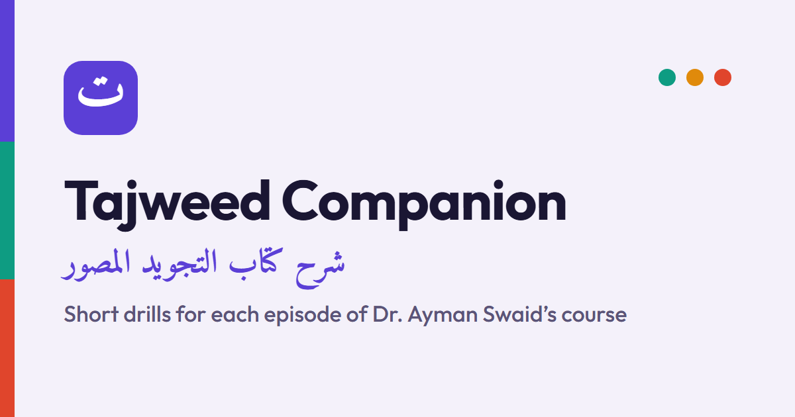

# Tajweed Companion

Short interactive drills for Dr. Ayman Rushdi Swaid's 45-episode video
commentary on **التجويد المصور**. Each episode has one unit: a few teaching
cards, then about twelve questions. A unit takes around four minutes.

**Live:** https://tajweed-companion.web.app/

## What it is

A study aid to use alongside the lessons. The teaching is the Shaykh's, every
unit links to the episode it goes with, and nothing here reproduces his book.

A web page cannot hear your recitation. Where a drill asks you to say a letter
and notice something, it says plainly that you are the judge.

## Accuracy

Every unit was drafted from the lesson transcript and checked twice before it
was published: once for tajweed under حفص عن عاصم, and once for the exact text
and for whether each question has one clearly right answer. Questions that
could not be made clearly correct were deleted.

Every Qurʾānic quotation is checked against the Uthmani text whenever the site
is built, on whole-word boundaries. Lines of **المقدمة الجزرية** follow a
109-verse edition. Editions differ, so verse numbers depend on the edition.

If you find a mistake, it is ours. Please open an issue.

## Features

- A tap-for-meaning glossary of the course's terms, and a searchable glossary page
- Al-Ḥuṣarī's recitation of each quoted āya, offered once you have answered
- Works offline and installs to a phone's home screen
- Progress saved after every answer; a drill left half-way can be resumed
- Optional Google sign-in to keep progress in step across devices

## Privacy

Without signing in, scores stay in your browser. Signing in with Google stores
your name, email address and your score for each unit, so they appear on all
your devices. You can delete all of it from the site's About and privacy page.
There are no analytics and no ads.

## Files

| Path | What |
|---|---|
| `site/` | the app, served by Firebase Hosting |
| `site/index.html`, `app.js`, `style.css` | the page, the drill engine, the styling |
| `site/data.js` | the episode list, the built units and the glossary (generated) |
| `site/sync.js`, `firebase-config.js` | optional Google sign-in and progress sync |
| `site/sw.js`, `manifest.webmanifest` | offline support and installing |
| `index.html` | forwards the old GitHub Pages address to the site |

`data.js` is generated from unit source files kept outside this repo. Deploy
with `firebase deploy --only hosting`.

## Licence

The drill questions and site code are MIT (see `LICENSE`). The Qurʾānic text
and المقدمة الجزرية are quoted as source material and are not ours to licence.
The lectures belong to their author.
